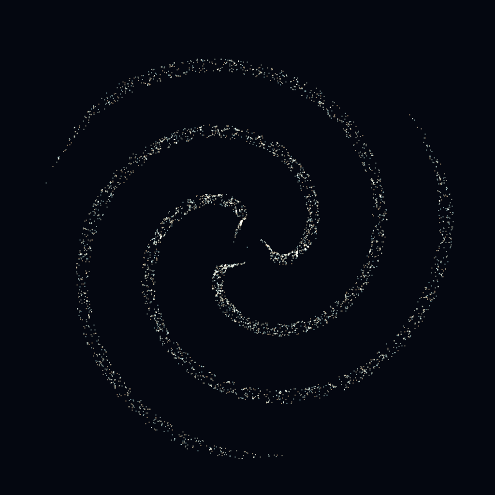
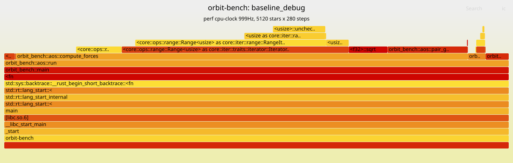
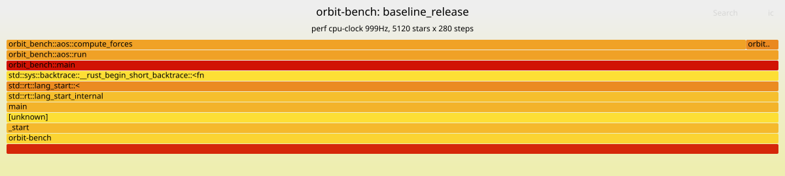
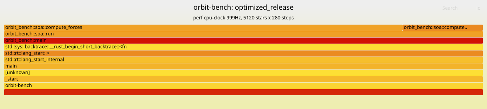
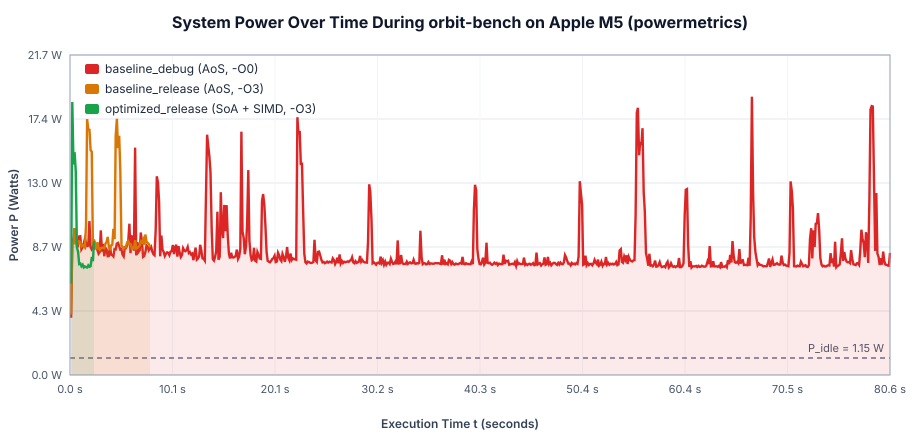

# orbit-bench

3D N-Body spiral galaxy simulation in pure Rust (`std`), built to benchmark compiler optimizations (`-O0` vs `-O3`), data layout (`AoS` vs `SoA`), SIMD auto-vectorization (`ARM64 NEON` / `x86-64 AVX2+FMA`), and CPU energy consumption.

<p align="center">
  
</p>

## Workload & Variants

Default workload: **5120 stars × 280 steps** ($7.34 \times 10^9$ pairwise gravity evaluations, total energy checked every 10 steps in `f64`).
Host: **Apple M5 (`arm64`)**, macOS 27.0.1 + Linux container (`Linux 6.10 aarch64`, `perf 6.1`).

| Variant | Layout | Flags | Description |Final Energy (`f64`) |
|---|---|---|---|---|
| `baseline_debug` | AoS (`Vec<Star>`, 64 B/star) | `-O0` | Unoptimized build with `pair_gravity` calls and `if i == j` branch | `-27628.862745` |
| `baseline_release` | AoS (`Vec<Star>`, 64 B/star) | `-O3` | Compiler-optimized AoS; strided memory access blocks vectorization | `-27628.861529` |
| `optimized_release` | SoA (`GalaxySoa`, 16 B hot/star) | `-O3` | Contiguous `x, y, z, mass` arrays, branchless softening, 8-lane SIMD blocking | `-27628.863387` |

All three variants start at `energy_init = -27627.401857` and converge to the same final mechanical energy within `f32` rounding (`< 10⁻⁷` relative difference).

---

## 1. FlameGraphs (1.1, 1.2, 4.3)

### 1.1 Live Pipeline Demo
```bash
./scripts/run_linux.sh demo baseline_release
# Runs: perf record -F 999 -g -> perf script -> stackcollapse-perf.pl -> flamegraph.pl
```

### 1.2 & 4.3 FlameGraph Comparison Before and After Optimization

**`baseline_debug` (`-O0`, AoS — 83,650 samples):**


**`baseline_release` (`-O3`, AoS — 7,774 samples):**


**`optimized_release` (`-O3`, SoA + SIMD — 2,377 samples):**


**Differential FlameGraph (`baseline_release` → `optimized_release`):**


**Interpretation:**
- **`baseline_debug` (`-O0`)**: Over 50% of CPU time is spent inside un-inlined range iterators (`Range::spec_next`, `Iterator::next`), non-inlined `pair_gravity` calls, and `<f32>::sqrt`.
- **`baseline_release` (`-O3`, AoS)**: LLVM inlines `pair_gravity` and range iterators into `aos::compute_forces`, which takes **95.79%** of runtime (`7,447` samples). `compute_total_energy` takes **4.21%** (`327` samples).
- **`optimized_release` (`-O3`, SoA + SIMD)**: `soa::compute_forces` drops from `7,447` to **`1,978` samples (3.76× fewer samples)**. Because `compute_forces` shrinks dramatically while `compute_total_energy` (`f64` verification) stays constant at ~`350–399` samples, the relative width of `compute_forces` shrinks from **95.79% → 83.21%**, and `compute_total_energy` expands fourfold from **4.21% → 16.79%**.

---

## 2. Execution Statistics & Hardware Counters (2.1, 2.2, 2.3, 4.2)

 Raw logs: [`results/time/`](results/time/), [`results/perf_stat/`](results/perf_stat/), [`results/perf_report/`](results/perf_report/), [`results/macos_counters/`](results/macos_counters/).

| Metric | Source | `baseline_debug` | `baseline_release` | `optimized_release` | Speedup (Debug → Opt / Rel → Opt) |
|---|---|---:|---:|---:|---:|
| **Wall time (Linux)** | `/usr/bin/time -v` | 85.23 s | 7.86 s | **2.42 s** | **35.2× / 3.25×** |
| **User / System time** | `/usr/bin/time -v` | 85.21 s / 0.00 s | 7.85 s / 0.00 s | **2.41 s / 0.00 s** | Pure user-space CPU load |
| **CPU utilization** | `/usr/bin/time -v` | 99% | 100% | **100%** | Single-threaded compute bound |
| **Max RSS / Minor faults** | `/usr/bin/time -v` | 2200 KB / 205 | 2136 KB / 202 | **2272 KB / 204** | 0 major faults, fits in RAM |
| **Involuntary ctx switches**| `/usr/bin/time -v` | 554 | 33 | **15** | Proportional to runtime |
| **Task clock** | `perf stat -d` | 83,848 ms | 7,797 ms | **2,380 ms** | **35.2× / 3.28×** |
| **Perf samples (`999 Hz`)** | `perf report` | 83,650 | 7,774 | **2,377** | `compute_forces`: 95.8% → 83.2% |
| **Wall time (macOS M5)** | `/usr/bin/time -l` | 80.52 s | 7.84 s | **2.30 s** | **35.0× / 3.41×** |
| **Throughput** | `orbit-bench` | 91.2 Mpairs/s | 936.0 Mpairs/s | **3194.7 Mpairs/s** | **35.0× / 3.41×** |
| **Instructions retired** | M5 PMU (`time -l`) | 1,442.42 × 10⁹ | 220.55 × 10⁹ | **42.58 × 10⁹** | **33.9× / 5.18× fewer** |
| **CPU cycles elapsed** | M5 PMU (`time -l`) | 349.05 × 10⁹ | 33.68 × 10⁹ | **9.89 × 10⁹** | **35.3× / 3.40× fewer** |
| **IPC (insn / cycle)** | M5 PMU (`time -l`) | 4.13 | 6.55 | **4.30** | 4-wide NEON vector ops replace scalar |

**Key observations:**
- In Docker on Apple Silicon, `perf stat -d` reports software counters (`task-clock`, `context-switches`, `page-faults`), while hardware PMU events report `<not supported>` because the hypervisor hides PMU registers. Native macOS `/usr/bin/time -l` reads the Apple M5 PMU directly.
- Moving from `baseline_release` (AoS) to `optimized_release` (SoA) cuts total retired instructions **5.18×** (`220.55B` → `42.58B`) because each 128-bit NEON `.4s` instruction processes 4 stars at once and eliminates the inner `if i == j` branch.
- Working set size in `compute_forces` drops from **320 KB** (`5120 × 64 B` in AoS, exceeding L1D cache) to **80 KB** (`5120 × 16 B` in SoA, fitting inside Apple M5's 128 KB L1D cache).

---

## 3. Power & Energy Consumption (3.1, 3.2, 4.4)

Measured natively on Apple M5 via `sudo powermetrics --samplers cpu_power,gpu_power,ane_power,tasks --show-process-energy -i 100`.
Raw tables and CSVs: [`results/energy/summary.txt`](results/energy/summary.txt), [`results/energy/summary.csv`](results/energy/summary.csv), [`results/energy/timeline.csv`](results/energy/timeline.csv).

| Phase | Samples | Time (s) | **3.1 System Power (W)** | **3.1 System Energy (J)** | **3.2 Process $\Delta P$ (W)** | **3.2 Process $\Delta E$ (J)** | **3.2 Task EI Energy (J)** | Energy Reduction vs Debug / Release |
|---|---:|---:|---:|---:|---:|---:|---:|---:|
| `idle` | 44 | 5.52 | 1.47 W | 8.13 J | 0.00 W | 0.00 J | 0.00 J | — |
| `baseline_debug` | 728 | 81.87 | 9.18 W | **751.66 J** | 7.71 W | **631.11 J** | **571.38 J** | 1.0× |
| `baseline_release` | 70 | 7.83 | 8.80 W | **68.93 J** | 7.33 W | **57.40 J** | **62.40 J** | 11.0× / 1.0× |
| `optimized_release` | 21 | 2.35 | 7.28 W | **17.12 J** | 5.83 W | **13.70 J** | **15.20 J** | **46.1× / 4.19×** |




**Methodology & Interpretation (3.1, 3.2, 4.4):**
- **3.1 System energy ($E_{\text{sys}} = \sum P_{\text{sys}} \Delta t$)**: Total SoC consumption (`CPU + GPU + ANE`) drops from **751.66 J** (`-O0`) to **68.93 J** (`-O3` AoS) and **17.12 J** (`-O3` SoA).
- **3.2 Process-isolated energy**: Evaluated using two cross-checked methods:
  1. *Idle-delta*: $P_{\Delta}(t) = \max(0, P_{\text{sys}}(t) - P_{\text{idle}})$ where $P_{\text{idle}} = 1.472\text{ W}$, yielding **631.11 J → 57.40 J → 13.70 J**.
  2. *Task Energy Impact share*: $P_{\text{task}}(t) = P_{\text{cpu}}(t) \cdot \frac{\text{EI}_{\text{orbit-bench}}}{\text{EI}_{\text{ALL\_TASKS}}}$ (accounting for Apple M5's asymmetric E-cores vs 4.6 GHz P-cores), yielding **571.38 J → 62.40 J → 15.20 J**.
- **4.4 Why energy dropped 4.19× after code optimization (`57.40 J → 13.70 J`)**:
  1. **Race to Idle**: Finishing the work **3.33× faster** (`7.83 s → 2.35 s`) returns the 4.6 GHz performance core to its low-power idle C-state much sooner.
  2. **Cache locality & instruction reduction**: Keeping `x, y, z, mass` in an 80 KB L1D-resident SoA layout avoids continuous L2/RAM cache-line transfers, and SIMD cuts instruction decoding/retirement by **5.18×**, lowering average process power from `7.33 W` to `5.83 W`.

---

## 4. Assembly & SIMD / AVX Analysis (4.1, 4.1.1)

Self-contained snippet for [godbolt.org](https://godbolt.org): [`results/asm/godbolt_example.rs`](results/asm/godbolt_example.rs).
Extracted assembly files: [`results/asm/`](results/asm/) ([`summary.txt`](results/asm/summary.txt)).

| File | Target & Flags | Lines | Vector Ops | Key Instructions |
|---|---|---:|---:|---|
| [`arm64_O0_aos.s`](results/asm/arm64_O0_aos.s) | ARM64 `-O0` (AoS) | 173 | 0 | `bl pair_gravity`, stack spills `[sp, #...]`, scalar `fadd s0, s0, s1` |
| [`arm64_O3_aos.s`](results/asm/arm64_O3_aos.s) | ARM64 `-O3` (AoS) | 59 | 0 (`.4s`) | Inlined loop, `add x15, x15, #64` stride, `b.eq` branch, scalar `fsqrt s7`, `fdiv s7` |
| [`arm64_O3_soa_neon.s`](results/asm/arm64_O3_soa_neon.s) | ARM64 `-O3` (SoA, **NEON 128-bit**) | 225 | **34** | `ld1r.4s`, `fsub.4s`, `fmla.4s`, `fsqrt.4s`, `fdiv.4s`, `fmul.4s` (4×`f32`/insn) |
| [`x86_64_O3_aos_sse2.s`](results/asm/x86_64_O3_aos_sse2.s) | x86-64 `-O3` (AoS) | 65 | 14 (partial) | `add rcx, 64` stride, `je` (`i == j`), scalar `sqrtss`, `divss`, `mulss` |
| [`x86_64_O3_soa_sse2.s`](results/asm/x86_64_O3_soa_sse2.s) | x86-64 `-O3` (SoA, **SSE2 128-bit**) | 245 | **103** | `subps`, `mulps`, `addps`, `sqrtps`, `divps` on `xmm` (4×`f32`/insn) |
| [`x86_64_O3_soa_avx2_fma.s`](results/asm/x86_64_O3_soa_avx2_fma.s) | x86-64 `-O3 -C target-cpu=x86-64-v3` (SoA, **AVX2+FMA 256-bit**) | 283 | **85** | `vbroadcastss`, `vsubps`, `vfmadd213ps`, `vfmadd231ps`, `vsqrtps`, `vdivps`, `vmulps` on `ymm` (**8×`f32`/insn**) |

### Inner Loop Comparison (`AoS` Scalar vs `SoA` AVX2+FMA vs `SoA` ARM64 NEON)

**1. `baseline_release` (`x86_64_O3_aos_sse2.s` — scalar `ss` instructions, 1 star per iteration):**
```asm
add     rcx, 64                 ; step by 64-byte Star struct (wastes 48B of cache line)
cmp     r8, rdx
je      .LBB0_4                 ; branch on i == j (blocks vectorization)
...
sqrtss  xmm2, xmm2              ; scalar square root (1 float)
divss   xmm3, xmm2              ; scalar division (1 float)
mulss   xmm2, dword ptr [rcx-52]; scalar multiply by mass
```

**2. `optimized_release` on x86-64 (`x86_64_O3_soa_avx2_fma.s` — 256-bit `ymm` AVX2+FMA, 8 stars in parallel):**
```asm
vbroadcastss ymm0, dword ptr [rax + r12] ; broadcast x[j] to 8 float lanes in ymm0
vsubps       ymm0, ymm0, ymm6            ; dx = x[j] - xi[0..8] (8 stars at once)
vbroadcastss ymm1, dword ptr [rcx + r12]
vsubps       ymm1, ymm1, ymm15           ; dy = y[j] - yi[0..8]
vbroadcastss ymm6, dword ptr [r8 + r12]
vsubps       ymm8, ymm6, ymm11           ; dz = z[j] - zi[0..8]
vfmadd213ps  ymm6, ymm0, ymm12           ; dist_sq = dx*dx + SOFTENING_SQ (FMA, 8 lanes)
vfmadd231ps  ymm6, ymm1, ymm1            ; dist_sq += dy*dy (FMA, 8 lanes)
vfmadd231ps  ymm6, ymm8, ymm8            ; dist_sq += dz*dz (FMA, 8 lanes)
vsqrtps      ymm6, ymm6                  ; 8-wide packed square root
vdivps       ymm6, ymm7, ymm6            ; 8-wide packed 1.0 / dist
```

**3. `optimized_release` on Apple M5 (`arm64_O3_soa_neon.s` — 128-bit `.4s` NEON FMA, 2×4 stars unrolled):**
```asm
ld1r.4s { v22 }, [x3], #4       ; load & broadcast x[j] into 4 float lanes
fsub.4s v24, v22, v2            ; dx for stars 0..4
fmla.4s v27, v24, v24           ; dist_sq += dx*dx (4-wide Fused Multiply-Add)
fmla.4s v27, v25, v25           ; dist_sq += dy*dy
fmla.4s v27, v28, v28           ; dist_sq += dz*dz
fsqrt.4s v27, v27               ; 4-wide vector square root
fdiv.4s v27, v1, v27            ; 4-wide vector reciprocal
fmla.4s v6, v27, v24            ; ax_acc[0..4] += s * dx
```

---

## Reproducing Everything

```bash
# Build & test natively
cargo test
cargo build --release
./target/release/orbit-bench --mode aos
./target/release/orbit-bench --mode soa

# 1. Live FlameGraph demo & full Linux profiling suite (Docker)
./scripts/run_linux.sh demo baseline_release
./scripts/run_linux.sh bench

# 2. Native Apple M5 hardware PMU counters
./scripts/macos_counters.sh

# 3. Extract ARM64 NEON and x86-64 SSE2/AVX2+FMA assembly
./scripts/extract_asm.sh

# 4. Measure M5 system & process energy via powermetrics (requires sudo)
./scripts/measure_energy.sh
```
