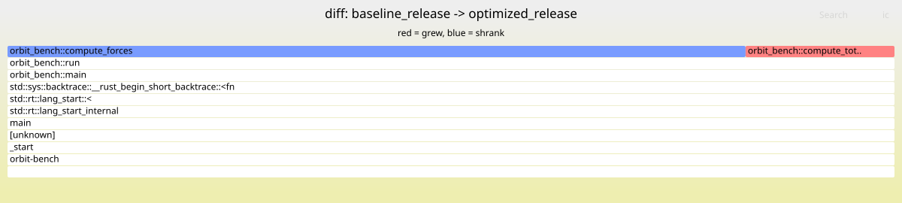
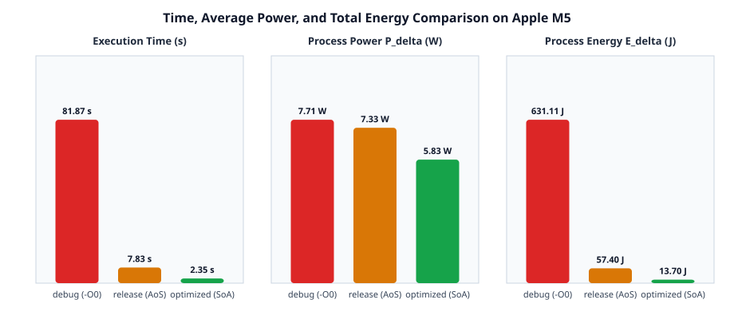

# orbit-bench

3D N-Body spiral galaxy simulation in pure Rust (`std`), comparing compiler optimizations (`-O0` vs `-O3`), memory layout (`AoS` vs `SoA`), SIMD auto-vectorization (`ARM64 NEON` and `x86-64 AVX2+FMA`), and CPU energy consumption on Apple M5.

<p align="center">
  
</p>

## Variants & Correctness

Default workload: **5120 stars × 280 timesteps** ($7.34 \times 10^9$ pairwise interactions). Total mechanical energy is recomputed in `f64` every 10 steps to verify simulation accuracy across implementations.

| Variant | Layout | Flags | Description | Final Energy (`f64`) |
|---|---|---|---|---|
| `baseline_debug` | AoS (`Vec<Star>`, 64 B) | `-O0` | Unoptimized build with non-inlined `pair_gravity` and `if i == j` branch | `-27628.862745` |
| `baseline_release` | AoS (`Vec<Star>`, 64 B) | `-O3` | Compiler-optimized AoS; strided 64 B access prevents vectorization | `-27628.861529` |
| `optimized_release` | SoA (`GalaxySoa`, 16 B hot) | `-O3` | Contiguous `x, y, z, mass` arrays, branchless softening, 8-lane SIMD blocking | `-27628.863387` |

All variants start at `energy_init = -27627.401857` and match within `f32` rounding (`< 10⁻⁷` relative error).

## Quick Start

```bash
cargo test
cargo build --release
./target/release/orbit-bench --mode aos
./target/release/orbit-bench --mode soa

./scripts/run_linux.sh demo baseline_release   # live FlameGraph pipeline demo (Docker)
./scripts/run_linux.sh bench                   # collect time -v, perf stat, perf report, FlameGraphs
./scripts/macos_counters.sh                    # collect native Apple M5 PMU counters
./scripts/extract_asm.sh                       # emit ARM64 NEON and x86-64 SSE2/AVX2+FMA assembly
./scripts/measure_energy.sh                    # measure system & process power via powermetrics (sudo)
```

## Performance & Hardware Counters

Raw outputs: [`results/time/`](results/time/), [`results/perf_stat/`](results/perf_stat/), [`results/perf_report/`](results/perf_report/), [`results/macos_counters/`](results/macos_counters/).

| Metric | Source | `baseline_debug` | `baseline_release` | `optimized_release` | Speedup (Debug → Opt / Rel → Opt) |
|---|---|---:|---:|---:|---:|
| **Wall time (Linux)** | `/usr/bin/time -v` | 85.23 s | 7.86 s | **2.42 s** | **35.2× / 3.25×** |
| **User / System time** | `/usr/bin/time -v` | 85.21 s / 0.00 s | 7.85 s / 0.00 s | **2.41 s / 0.00 s** | 99–100% CPU, user-space bound |
| **Max RSS / Minor faults** | `/usr/bin/time -v` | 2200 KB / 205 | 2136 KB / 202 | **2272 KB / 242** | 0 major page faults in release |
| **Involuntary ctx switches**| `/usr/bin/time -v` | 554 | 33 | **13** | Proportional to runtime (~5/s) |
| **Task clock** | `perf stat -d` | 83,637 ms | 7,863 ms | **2,373 ms** | **35.2× / 3.31×** |
| **Perf samples (`999 Hz`)** | `perf report` | 83,650 | 7,774 | **2,377** | `compute_forces`: 95.8% → 83.2% |
| **Wall time (macOS M5)** | `/usr/bin/time -l` | 80.52 s | 7.84 s | **2.30 s** | **35.0× / 3.41×** |
| **Throughput** | `orbit-bench` | 91.2 Mpairs/s | 936.0 Mpairs/s | **3194.7 Mpairs/s** | **35.0× / 3.41×** |
| **Instructions retired** | M5 PMU (`time -l`) | 1,442.42 × 10⁹ | 220.55 × 10⁹ | **42.58 × 10⁹** | **33.9× / 5.18× fewer** |
| **CPU cycles elapsed** | M5 PMU (`time -l`) | 349.05 × 10⁹ | 33.68 × 10⁹ | **9.89 × 10⁹** | **35.3× / 3.40× fewer** |
| **IPC (insn / cycle)** | M5 PMU (`time -l`) | 4.13 | 6.55 | **4.30** | 4-wide NEON replaces scalar ops |

- **PMU in Docker vs Native M5**: Inside the Linux container on Apple Silicon, `perf stat -d` captures software events (`task-clock`, `page-faults`, `context-switches`) while hardware PMU counters report `<not supported>` due to hypervisor isolation. Native macOS `/usr/bin/time -l` reads M5 PMU counters directly.
- **Instruction & Cache Reduction**: Switching from `AoS` (`320 KB`, exceeding L1D) to `SoA` (`80 KB` for `x, y, z, mass`, fitting inside M5's 128 KB L1D cache) and vectorizing with 128-bit NEON reduces retired instructions **5.18×** and CPU cycles **3.40×**.

## FlameGraphs

Generated via `perf record -e cpu-clock -F 999 --call-graph fp` → `perf script` → `stackcollapse-perf.pl` → `flamegraph.pl` ([`results/flamegraphs/`](results/flamegraphs/)).




- **`baseline_debug` (`-O0`)**: Over 50% of samples land in un-inlined `Range::next` iterators, separate `pair_gravity` calls, and `<f32>::sqrt`.
- **`baseline_release` (`-O3`, AoS)**: Helpers inline into `aos::compute_forces`, which accounts for **95.79%** of execution (`7,447` samples) vs **4.21%** (`327` samples) in `compute_total_energy`.
- **`optimized_release` (`-O3`, SoA + SIMD)**: `soa::compute_forces` drops **3.76×** in absolute sample count (`7,447 → 1,978` samples). Consequently, its relative width shrinks from **95.79% → 83.21%**, while `compute_total_energy` grows from **4.21% → 16.79%**.

## Assembly & SIMD Vectorization

Standalone snippet for [godbolt.org](https://godbolt.org): [`results/asm/godbolt_example.rs`](results/asm/godbolt_example.rs). Extracted functions: [`results/asm/`](results/asm/) ([`summary.txt`](results/asm/summary.txt)).

| File | Target & Flags | Lines | Vector Ops | Key Instructions |
|---|---|---:|---:|---|
| [`arm64_O0_aos.s`](results/asm/arm64_O0_aos.s) | ARM64 `-O0` (AoS) | 173 | 0 | `bl pair_gravity`, stack spills, scalar `fadd s0, s0, s1` |
| [`arm64_O3_aos.s`](results/asm/arm64_O3_aos.s) | ARM64 `-O3` (AoS) | 59 | 0 (`.4s`) | `#64` struct stride, `b.eq` (`i == j`), scalar `fsqrt s7`, `fdiv s7` |
| [`arm64_O3_soa_neon.s`](results/asm/arm64_O3_soa_neon.s) | ARM64 `-O3` (SoA, **NEON 128-bit**) | 225 | **34** | `ld1r.4s`, `fsub.4s`, `fmla.4s`, `fsqrt.4s`, `fdiv.4s`, `fmul.4s` (4×`f32`/insn) |
| [`x86_64_O3_aos_sse2.s`](results/asm/x86_64_O3_aos_sse2.s) | x86-64 `-O3` (AoS) | 65 | 14 (partial) | `add rcx, 64` stride, `je` (`i == j`), scalar `sqrtss`, `divss`, `mulss` |
| [`x86_64_O3_soa_sse2.s`](results/asm/x86_64_O3_soa_sse2.s) | x86-64 `-O3` (SoA, **SSE2 128-bit**) | 245 | **103** | `subps`, `mulps`, `addps`, `sqrtps`, `divps` on `xmm` (4×`f32`/insn) |
| [`x86_64_O3_soa_avx2_fma.s`](results/asm/x86_64_O3_soa_avx2_fma.s) | x86-64 `-O3 -C target-cpu=x86-64-v3` (SoA, **AVX2+FMA 256-bit**) | 283 | **85** | `vbroadcastss`, `vsubps`, `vfmadd213ps`, `vfmadd231ps`, `vsqrtps`, `vdivps` on `ymm` (**8×`f32`/insn**) |

**Inner loop before (`AoS` scalar `ss` on x86-64) vs after (`SoA` 256-bit `ymm` AVX2+FMA and 128-bit `.4s` ARM64 NEON):**
```asm
; AoS (-O3, scalar): 64-byte stride + branch on i == j, 1 float per instruction
add     r9, 64
cmp     rcx, r8
je      .LBB0_4
sqrtss  xmm7, xmm10
divss   xmm9, xmm7

; SoA (-O3, x86-64 AVX2+FMA): branchless, 8 floats per 256-bit ymm instruction
vbroadcastss ymm0, dword ptr [rax + r12]
vsubps       ymm0, ymm0, ymm6
vfmadd213ps  ymm6, ymm0, ymm12
vfmadd231ps  ymm6, ymm1, ymm1
vfmadd231ps  ymm6, ymm8, ymm8
vsqrtps      ymm6, ymm6
vdivps       ymm6, ymm7, ymm6

; SoA (-O3, ARM64 NEON): branchless, 4 floats per 128-bit .4s instruction (2x unrolled = 8 stars)
ld1r.4s { v22 }, [x3], #4
fsub.4s v24, v22, v2
fmla.4s v27, v24, v24
fsqrt.4s v27, v27
fdiv.4s v27, v1, v27
```

## Power & Energy Analysis

Measured natively on Apple M5 via `sudo powermetrics --samplers cpu_power,gpu_power,ane_power,tasks --show-process-energy -i 100` ([`results/energy/`](results/energy/)).

| Phase | Samples | Time (s) | System Power (W) | System Energy (J) | Process $\Delta P$ (W) | Process $\Delta E$ (J) | Task EI Energy (J) | Energy Reduction |
|---|---:|---:|---:|---:|---:|---:|---:|---:|
| `idle` | 44 | 5.52 | 1.47 W | 8.13 J | 0.00 W | 0.00 J | 0.00 J | — |
| `baseline_debug` | 728 | 81.87 | 9.18 W | **751.66 J** | 7.71 W | **631.11 J** | **571.38 J** | 1.0× |
| `baseline_release` | 70 | 7.83 | 8.80 W | **68.93 J** | 7.33 W | **57.40 J** | **62.40 J** | 11.0× vs debug |
| `optimized_release` | 21 | 2.35 | 7.28 W | **17.12 J** | 5.83 W | **13.70 J** | **15.20 J** | **46.1× vs debug / 4.19× vs release** |




- **System vs Process Energy**: Whole-SoC energy ($E_{\text{sys}} = \sum P_{\text{sys}}\Delta t$) drops from **751.66 J → 68.93 J → 17.12 J**. Process-only energy is isolated via two cross-checked methods: idle subtraction ($P_{\Delta} = P_{\text{sys}} - P_{\text{idle}}$, giving **631.11 J → 57.40 J → 13.70 J**) and per-task Energy Impact attribution ($P_{\text{cpu}} \cdot \text{EI}_{\text{orbit-bench}} / \text{EI}_{\text{ALL\_TASKS}}$, giving **571.38 J → 62.40 J → 15.20 J**).
- **Why optimization saves 4.19× energy over `-O3` AoS**: Completing the workload **3.33× faster** returns the 4.6 GHz performance core to deep idle C-states sooner (*Race to Idle*), while L1D-resident SoA arrays and 5.18× fewer retired instructions reduce average dynamic power from `7.33 W` to `5.83 W`.
